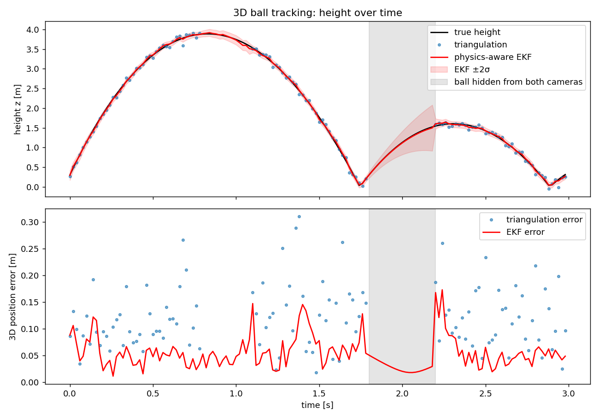

# Physics-Aware 3D Ball Tracking

Tracking a ball in 3D from cameras is hard: measurements are noisy, players hide the ball, and frame-by-frame triangulation only works when several cameras see it at the same time. This project shows how a **physics model of ball flight** combined with an **Extended Kalman Filter (EKF)** gives more accurate tracking that keeps working through occlusions, and that honestly reports its own uncertainty.



## What the simulation does

1. **Ball physics** – a football in flight with gravity, quadratic air drag (`a = g − k·|v|·v`) and bounces using a coefficient of restitution.
2. **Two calibrated cameras** – pinhole camera models (intrinsics + extrinsics) project the 3D ball into 1920×1080 images, with 2-pixel measurement noise.
3. **Occlusions** – the ball is hidden from one camera for part of the play, and from both cameras for 0.4 s.
4. **Two estimators**
   - **Triangulation (DLT):** recovers the 3D position frame by frame, but only when both cameras see the ball.
   - **Physics-aware EKF:** predicts the motion with the physics model and corrects it with whichever camera measurements are available (two, one or none).

## Results

| Method | 3D position error (RMSE) | Frames covered |
|---|---|---|
| Triangulation | 0.134 m | 77 % (needs both cameras) |
| EKF, both cameras visible | 0.067 m | |
| EKF, one camera visible | 0.051 m | |
| EKF, ball fully hidden (prediction only) | 0.030 m | |
| **EKF overall** | | **100 %** |

The EKF halves the error of triangulation, keeps tracking with a single camera and predicts through a full occlusion. The shaded band in the plot shows its ±2σ uncertainty: it **grows while the ball is hidden** and shrinks again when the cameras see it.

## Run it

```bash
pip install -r requirements.txt
python ball_tracking_demo.py
```

The script prints the error statistics and saves `ball_tracking_results.png`.

## Limitations and next steps

- In this simulation the filter's physics model matches the "true" physics, so prediction through occlusions is optimistic. A real ball **spins** (Magnus effect, e.g. a curling free kick), **swings** (seam effects in cricket), deforms on bounces and meets wind.
- Next steps:
  - add spin to the state and estimate it from the measurements (Magnus force `∝ ω × v`)
  - estimate the bounce coefficient online, since it depends on the surface
  - a forward–backward smoother for offline, higher-accuracy trajectories
  - real video: ball detection with OpenCV / a CNN detector and camera calibration from known pitch lines
  - a cricket-ball version with swing and the bounce off the pitch

## Author

Nithyasri Rajulu – M.Sc. Mechatronics, KTH Royal Institute of Technology
[Portfolio](https://nithyasri-rajulu.github.io) · [LinkedIn](https://linkedin.com/in/nithyasri-rajulu-23813925a)
